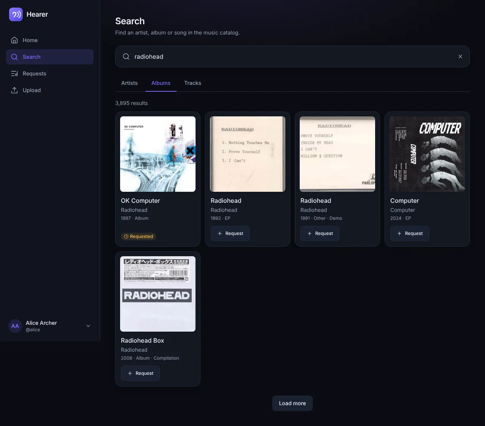
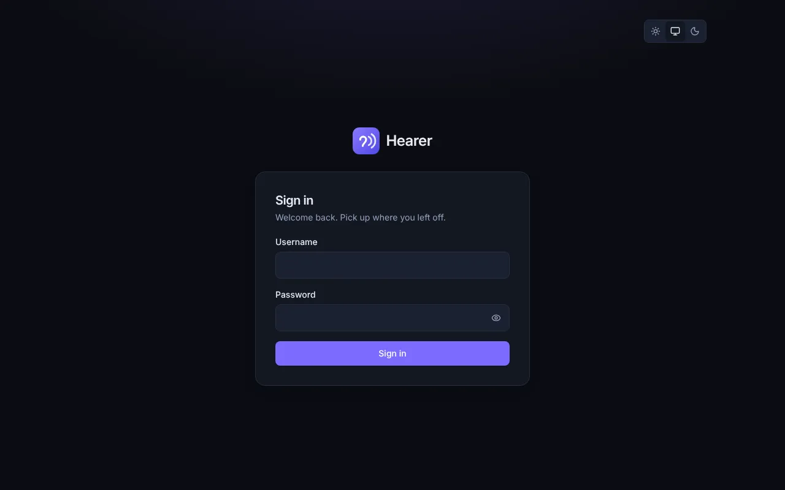
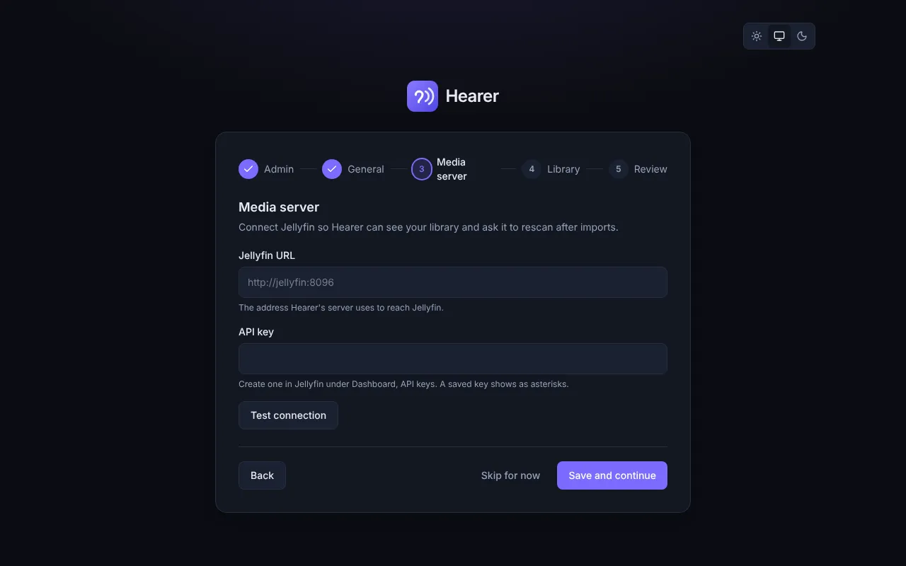
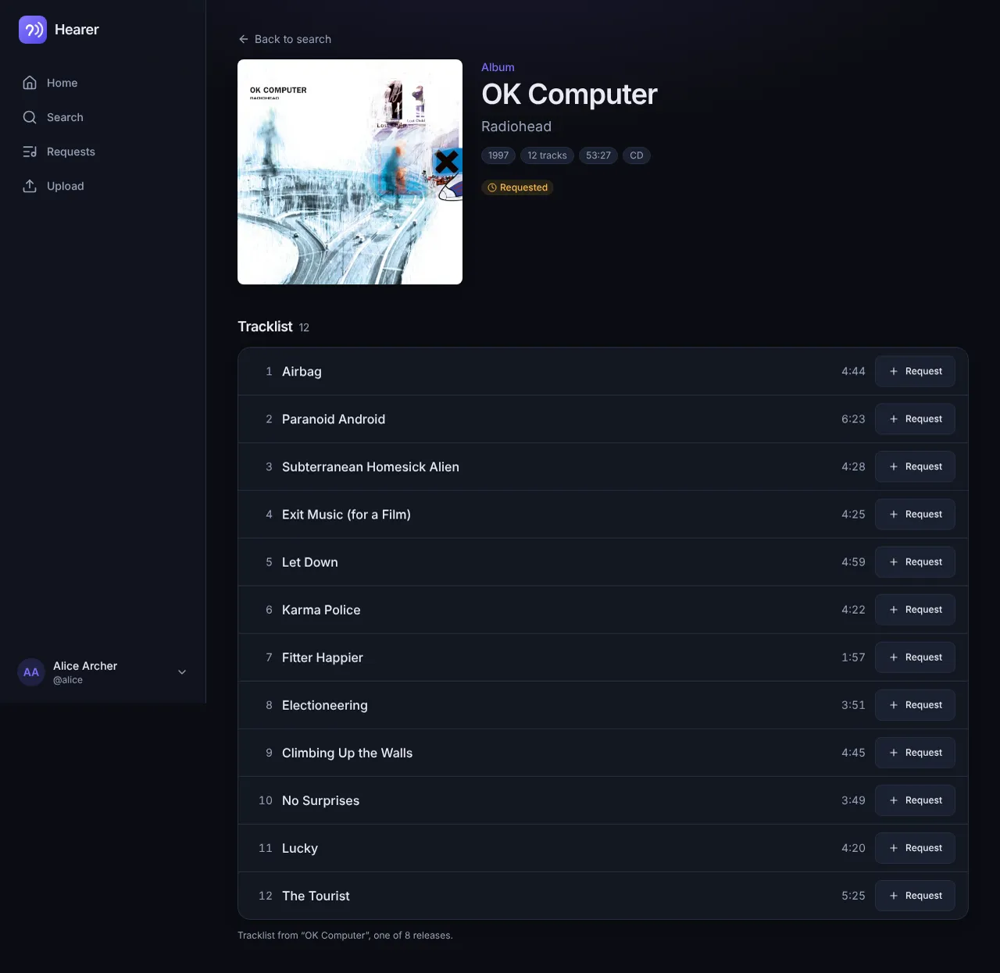
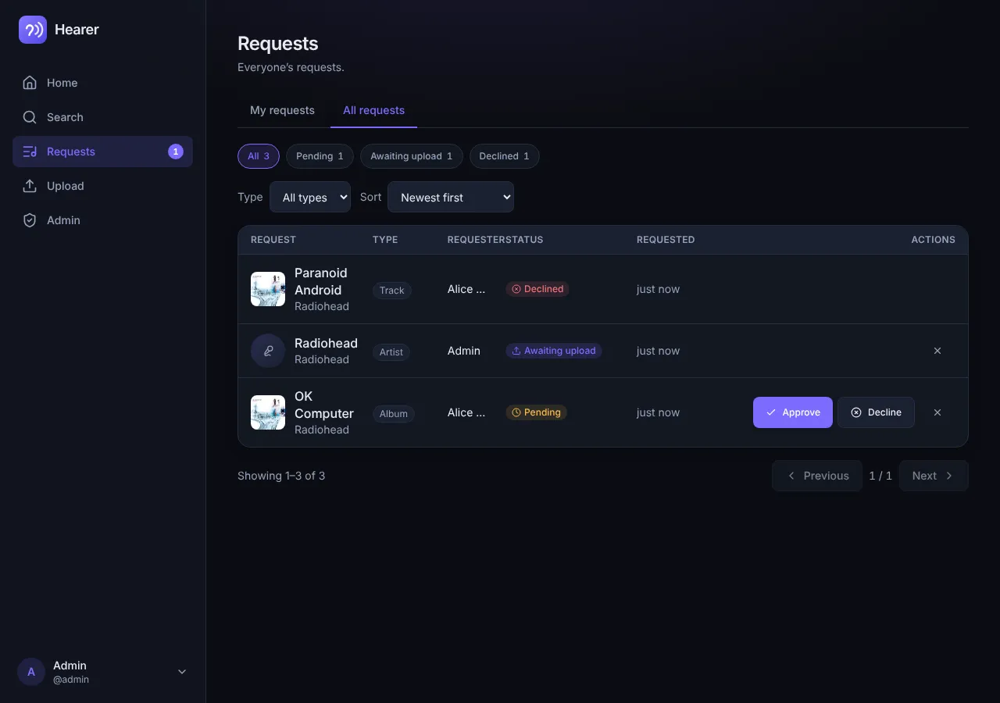

# Hearer

A self-hosted request and upload portal for music, in the spirit of Seerr and Jellyseerr but built around music.

People sign in with their Jellyfin account (or a local account, or your single sign-on), search MusicBrainz, and request tracks, albums or artists. They can also upload music they own. Requests go through approval and are fulfilled by pluggable providers. Uploads are fingerprinted, matched, reviewed, tagged and filed into your library, and Jellyfin is told to rescan. Hearer notices when requested music appears in the library and lets people know.

> **Status: beta (pre-1.0).** Hearer is feature complete for its first release and runs, but it is young: expect rough edges, read the release notes before upgrading, and keep a backup of `/data`. The API and settings may still change before 1.0.



## Features

- **Setup wizard:** administrator, media server (with a connection test), library and staging folders, naming template with a live preview
- **Sign in** with Jellyfin, a local account or generic OpenID Connect (Keycloak, Authentik, ...); sessions and API keys; fine-grained permissions and per-user quotas
- **Search** artists, albums and tracks (MusicBrainz, Cover Art Archive) with "in library" and "requested" badges
- **Requests:** approve or decline (with a reason), retry, cancel, a status timeline, auto-approve per permission, partial availability for albums
- **Fulfillment providers:** Manual (an upload fills the request) and Lidarr
- **Library sync** from Jellyfin and automatic availability detection (MusicBrainz ids first, fuzzy match as a fallback)
- **Uploads:** resumable, chunked (tus) so they work behind Cloudflare; ffprobe validation, AcoustID fingerprinting, candidate matching, review and tag editing, duplicate detection, tag writing with cover art, filing by template, targeted Jellyfin rescan, optional "this fulfills request #N"
- **Notifications:** webhook (n8n and friends), Discord, Slack, ntfy and SMTP, per-event toggles, and per-user opt-in for your own requests
- **Admin pages** for users, requests, uploads, background jobs and settings
- **One container**, multi-arch (amd64 and arm64), with ffmpeg and Chromaprint included; no database server, no Redis

Not planned for 1.0: playback, Postgres, Navidrome/Plex adapters, mobile apps, recommendations, playlist import. See [docs/DECISIONS.md](docs/DECISIONS.md).

## Quick start

You need Docker, a music folder and (optionally) a Jellyfin server.

```sh
mkdir hearer && cd hearer
curl -fsSLO https://raw.githubusercontent.com/buschmjm/hearer/main/docker-compose.example.yml
mv docker-compose.example.yml docker-compose.yml
```

Edit `docker-compose.yml`: set `PUID` and `PGID` to the owner of your music files (`ls -ln /path/to/music`) and point the `/music` volume at your library. Then:

```sh
docker compose up -d
```

Open **http://your-host:5055** and follow the setup wizard: create the administrator, enter your Jellyfin URL and API key, check the folders, finish. That is it; the wizard takes a few minutes.

Prefer plain `docker run`?

```sh
docker run -d --name hearer --restart unless-stopped -p 5055:5055 \
  -e PUID=1000 -e PGID=1000 \
  -v "$PWD/data:/data" -v /path/to/music:/music -v "$PWD/staging:/staging" \
  ghcr.io/buschmjm/hearer:edge
```

`:edge` tracks the main branch; switch to `:latest` or a version tag once releases are published.

Putting it on the internet? Read [Reverse proxies](docs/DEPLOY.md#reverse-proxies) first (a 55 MB body limit and no request buffering), and set `BASE_URL` and `TRUST_PROXY`.

## Screenshots

| Sign in                                 | Setup wizard                                                     |
| --------------------------------------- | ---------------------------------------------------------------- |
|  |  |

| Album page                               | Requests queue                                   |
| ---------------------------------------- | ------------------------------------------------ |
|  |  |

## Documentation

- [Deploying](docs/DEPLOY.md): docker run and compose, permissions, reverse proxies, Cloudflare Tunnel, Jellyfin, single sign-on, upgrades, troubleshooting
- [Configuration](docs/CONFIGURATION.md): every environment variable and setting, permissions, notifications, naming templates, quotas, security notes
- [Adapters](docs/ADAPTERS.md): the media server, fulfillment and notification contracts, for writing your own
- [Matching](docs/MATCHING.md): how uploads are identified and scored
- [Build plan](docs/PLAN.md), [locked decisions](docs/DECISIONS.md) and the [status log](docs/STATUS.md)
- [Contributing](CONTRIBUTING.md), [Code of Conduct](CODE_OF_CONDUCT.md), [Security policy](SECURITY.md)

## Development

Requires Node 24 and pnpm 10. See [CONTRIBUTING.md](CONTRIBUTING.md).

```sh
pnpm install
pnpm lint && pnpm typecheck && pnpm test
pnpm dev     # server and web app with reload
pnpm e2e     # builds, then runs the browser tests against mock services
```

## License

[MIT](LICENSE)
